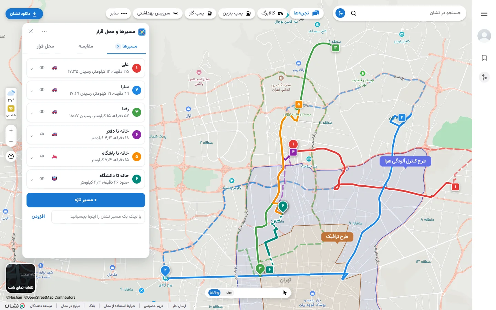
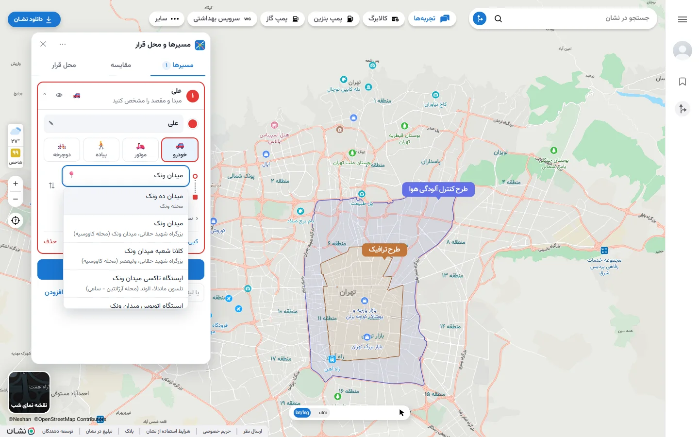
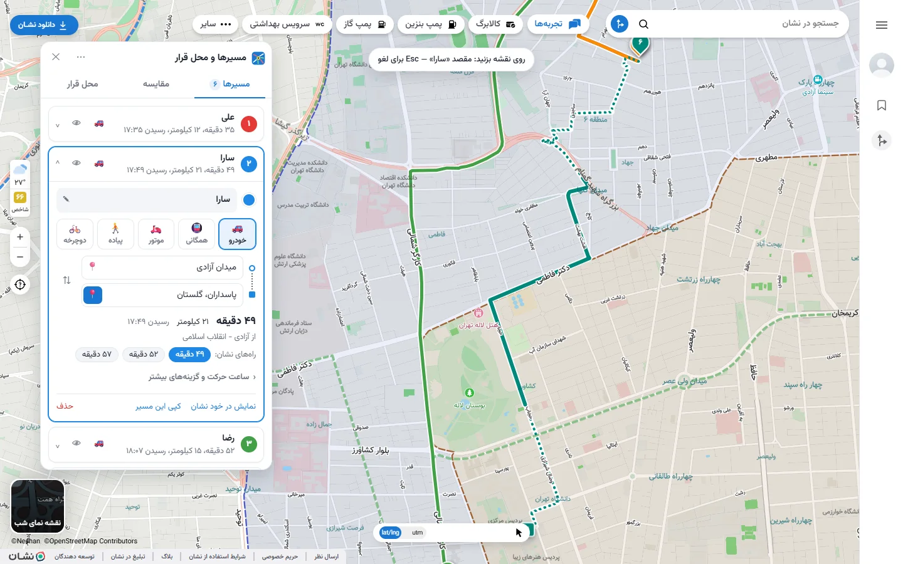
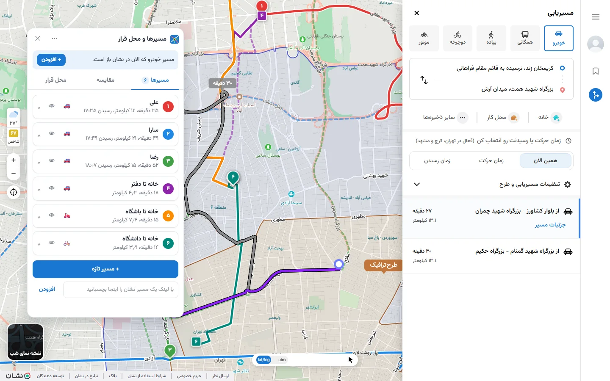
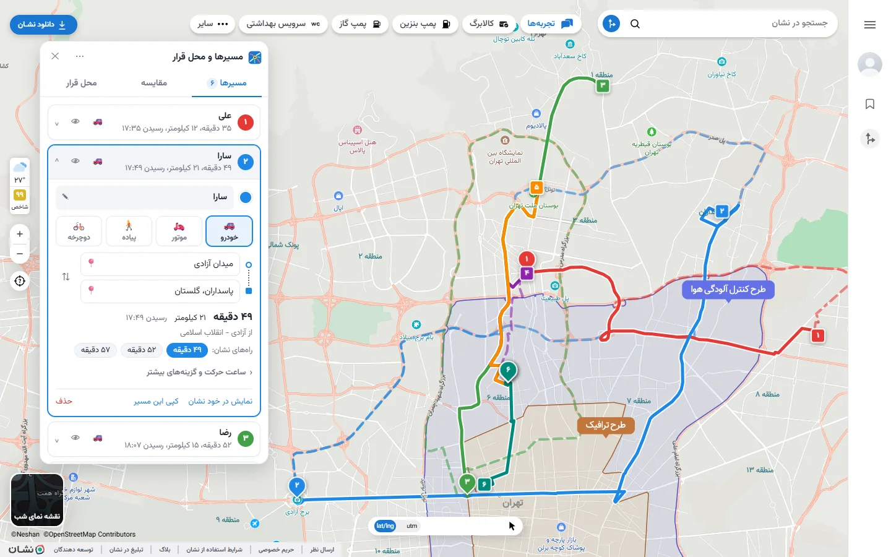
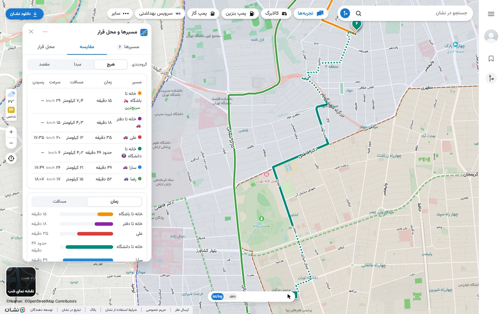
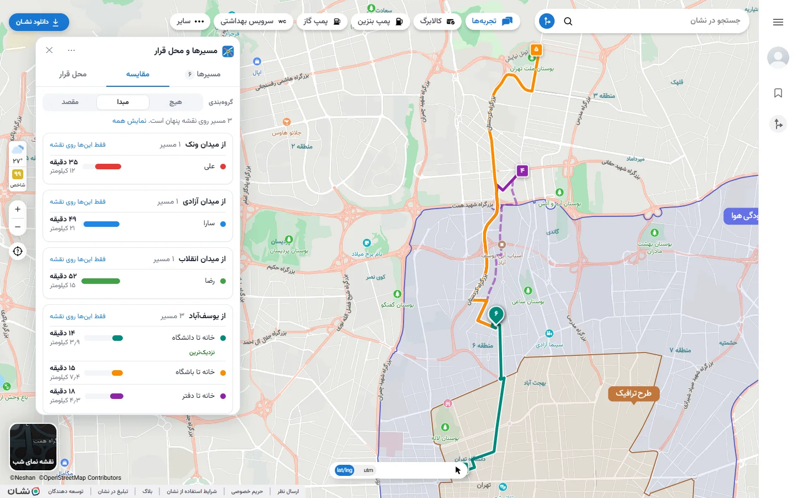
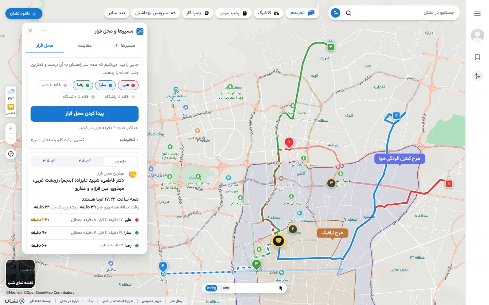
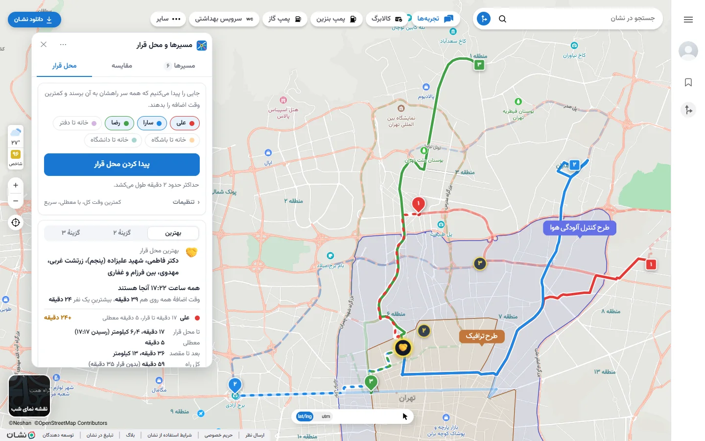
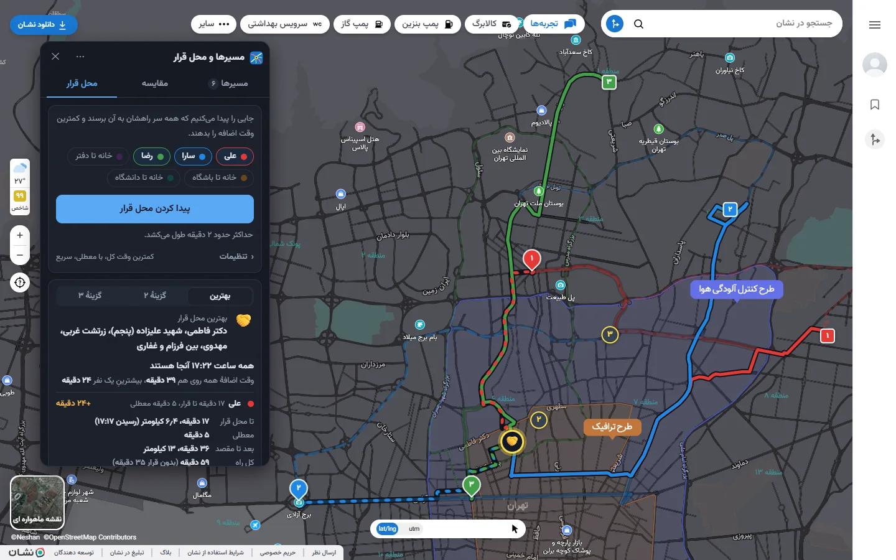

<div dir="rtl">

# مسیرها و محل قرار برای نقشهٔ نشان

افزونهٔ Chrome و Firefox که روی خود سایت [نقشهٔ نشان](https://neshan.org/maps) کار می‌کند. نشان هر بار فقط یک مسیر نشان می‌دهد؛ با این افزونه **چند مسیر را هم‌زمان روی نقشهٔ نشان** می‌بینید، اسم می‌گذارید، مقایسه می‌کنید و **جایی برای قرار گذاشتن پیدا می‌کنید که سر راه همه باشد**.

**[نصب در یک دقیقه، بدون هیچ برنامهٔ اضافه ←](#نصب-سریع)**



> این افزونه رسمی نیست و هیچ وابستگی‌ای به نشان ندارد. از همان سرویس‌هایی استفاده می‌کند که خود سایت neshan.org برای مسیریابی و جستجو به کار می‌برد و کلید API لازم ندارد.

## چه کارهایی می‌شود کرد؟

### ۱. چند مسیر روی یک نقشه

هر مسیر یک خط در فهرست است: شماره و رنگش با نشانگرهای روی نقشه یکی است و زمان و مسافت جلویش نوشته شده. با 👁 هر مسیر را از روی نقشه پنهان یا آشکار کنید.

### ۲. ساختن و ویرایش مسیر

«+ مسیر تازه» را بزنید، اسمی بگذارید (مثلاً «علی» یا «خانه تا دفتر») و مبدا و مقصد را بدهید. هر کدام از این راه‌ها کار می‌کند:

- **جستجوی نشان:** بنویسید و از فهرست انتخاب کنید.



- **کلیک روی نقشه:** 📍 را بزنید و روی نقشه کلیک کنید. نشانگرها را بعداً هم می‌شود روی نقشه کشید.



- **مختصات** (مثل `35.7572, 51.4099`) یا **لینک یک مسیر نشان**، در خانهٔ مبدا یا در کادر پایین فهرست.
- اگر در خود نشان مسیری باز باشد، بالای پنل دکمهٔ «افزودن» می‌آید و همان مسیر با یک کلیک اضافه می‌شود.



با کلیک روی هر خط، همان مسیر باز می‌شود: وسیله (خودرو، موتور، پیاده، دوچرخه)، جابه‌جایی مبدا و مقصد با ⇅، و راه‌های دیگری که نشان پیشنهاد داده. ساعت حرکت (۲۴ ساعته) و «بدون طرح ترافیک / زوج و فرد / عوارضی» زیر «ساعت حرکت و گزینه‌های بیشتر» هستند.



### ۳. مقایسه

تب «مقایسه» زمان، مسافت، سرعت و ساعت رسیدن همهٔ مسیرها را کنار هم می‌گذارد، با نمودار زمان یا مسافت و فهرست مسیرهایی که بیشترین راه مشترک را دارند.



**گروه‌بندی بر اساس مبدا یا مقصد:** مسیرهایی که از یک جا شروع می‌شوند (یا به یک جا می‌رسند) کنار هم و به ترتیب زمان می‌آیند. با «فقط این‌ها روی نقشه» بقیه موقتاً پنهان می‌شوند.



### ۴. پیدا کردن محل قرار

چند نفر از جاهای مختلف به مقصدهای مختلف می‌روند و می‌خواهند وسط راه همدیگر را ببینند. تب «محل قرار» جایی را پیدا می‌کند که هر کس سر راهش به آن برسد و بعد از قرار هم مسیرش زیاد دور نشود.

- روی اسم‌ها بزنید تا مشخص شود چه کسانی قرار می‌گذارند.
- «بهترین» یعنی **کمترین وقت اضافه در مجموع**، یا **عادلانه** (بدترین وضع برای هیچ‌کس بد نشود). معطل شدن برای بقیه هم می‌تواند حساب شود.
- اگر ساعت حرکت هر نفر را داده باشید، ساعت رسیدن هم محاسبه می‌شود.



نتیجه: نشانی محل قرار، ساعتی که همه آنجا هستند، و برای هر نفر وقت اضافه، معطلی، زمان تا قرار و از قرار تا مقصد، با لینک هر تکهٔ مسیر در نشان. دو گزینهٔ دیگر هم پیشنهاد می‌شود و با کشیدن 🤝 روی نقشه می‌شود هر جای دیگری را هم سنجید.



### ۵. نقشهٔ نمای شب

با «نقشه نمای شب» نشان، پنل هم تیره می‌شود.



### نکته‌های دیگر

- همه‌چیز خودکار در حافظهٔ افزونه ذخیره می‌شود. از منوی ⋯ می‌شود مسیرها را در فایل ذخیره کرد یا از فایل برگرداند.
- آیکون افزونه در نوار ابزار پنل را باز و بسته می‌کند، و اگر نشان باز نباشد آن را باز می‌کند.

## نصب سریع

فایل آماده را دانلود کنید و در مرورگر وارد کنید؛ به هیچ برنامهٔ دیگری نیاز نیست. همهٔ نسخه‌ها در بخش [Releases](https://github.com/vahidbaghi/neshan-routes/releases/latest) هستند.

### برای Chrome، Edge و مرورگرهای مشابه

۱. فایل [`neshan-routes-chrome.zip`](https://github.com/vahidbaghi/neshan-routes/releases/latest/download/neshan-routes-chrome.zip) را دانلود و از حالت فشرده خارج کنید.

۲. در نوار آدرس مرورگر بنویسید `chrome://extensions`؛ در Edge بنویسید `edge://extensions`.

۳. کلید **Developer mode** را روشن کنید.

۴. دکمهٔ **Load unpacked** را بزنید و پوشه‌ای را که از فایل zip بیرون آمد انتخاب کنید.

### برای Firefox (نسخهٔ ۱۲۸ به بعد)

۱. فایل [`neshan-routes-firefox.zip`](https://github.com/vahidbaghi/neshan-routes/releases/latest/download/neshan-routes-firefox.zip) را دانلود کنید (لازم نیست باز شود).

۲. در نوار آدرس بنویسید `about:debugging#/runtime/this-firefox`

۳. دکمهٔ **Load Temporary Add-on** را بزنید و همان فایل zip را انتخاب کنید.

> نکته: Firefox افزونه‌ای را که Mozilla امضا نکرده فقط موقت نصب می‌کند و با بستن مرورگر حذف می‌شود. قبل از بستن، از منوی ⋯ در پنل «ذخیره در فایل» را بزنید تا مسیرهایتان بماند.

### شروع

سایت [neshan.org/maps](https://neshan.org/maps) را باز کنید؛ پنل افزونه سمت چپ نقشه است.

## ساختن از روی کد

برای وقتی که می‌خواهید کد را تغییر دهید یا خودتان بسته را بسازید. [Node.js](https://nodejs.org) لازم است.

۱. ریپو را بگیرید و در پوشه‌اش این دو دستور را اجرا کنید:

</div>

```bash
npm install
node build.mjs
```

<div dir="rtl">

۲. خروجی در پوشهٔ `dist` است: پوشهٔ `dist/chrome` برای Chrome و `dist/firefox` برای Firefox، به‌علاوهٔ فایل zip هر کدام.

۳. مثل نصب سریع وارد مرورگر کنید. در Chrome با **Load unpacked** پوشهٔ `dist/chrome` را انتخاب کنید و در Firefox با **Load Temporary Add-on** فایل `dist/firefox/manifest.json` را.

۴. بعد از هر تغییر در کد، دوباره `node build.mjs` را اجرا کنید و در صفحهٔ افزونه‌های مرورگر، افزونه را reload کنید. مسیرهای ذخیره‌شده نمی‌پرند.

## پشت صحنه

- پنل داخل صفحهٔ نشان اجرا می‌شود و خط‌ها را به‌صورت لایه روی همان نقشهٔ نشان می‌کشد.
- **محل قرار:** برای هر نقطهٔ پیشنهادی، زمان «مبدا ← قرار ← مقصد» هر نفر با «مبدا ← مقصد» مقایسه می‌شود. اول صدها نقطه روی مسیرها و اطرافشان با یک تخمین سریع رتبه‌بندی می‌شوند. چند نقطهٔ برتر با مسیریابی واقعی نشان سنجیده می‌شوند و تخمین بر اساس آن‌ها تصحیح می‌شود. در آخر اطراف بهترین نقطه دقیق‌تر جستجو می‌شود. نقطه‌ای که روی مسیر خود یک نفر باشد برای او درخواستی لازم ندارد.
- **مراعات سرور نشان:** درخواست‌های مسیریابی با فاصله فرستاده می‌شوند و تعدادشان سقف دارد. اگر نشان بگوید «آهسته‌تر»، افزونه صبر می‌کند، آهسته‌تر ادامه می‌دهد و این سرعت را به خاطر می‌سپارد. مسیرهای گرفته‌شده تا ۳۰ دقیقه دوباره استفاده می‌شوند.
- اگر نشان سایتش را تغییر دهد، ممکن است افزونه نیاز به به‌روزرسانی داشته باشد.

## توسعه و تست

</div>

```bash
npm test                                          # unit tests (decoding, meeting-point search vs brute force, pacing)
node build.mjs --test                             # adds the fake Neshan API to dist-test/
python -I tests/e2e/offline_ui.py <out-dir>       # whole panel UI, offline (no neshan.org)
python -I tests/e2e/run_e2e.py chrome fake <out>  # on neshan.org in Chrome (also: firefox)
python -I tools/screenshots.py --proxy <proxy>    # README screenshots (real API, ~60 requests)
```

<div dir="rtl">

تست‌های مرورگر به Chrome و Firefox نصب‌شده و `pip install playwright selenium pillow` نیاز دارند. تست‌هایی که neshan.org را باز می‌کنند را کم و با فاصله اجرا کنید تا به محدودیت نشان نخورید.

</div>

---

**English:** a Chrome/Firefox extension that runs on [neshan.org/maps](https://neshan.org/maps) and draws several named routes at once on Neshan's own map, compares them (optionally grouped by origin or destination), and finds a meeting point on the way for several people (minimal total or fair detour, optional waiting time). Unofficial; uses the endpoints of Neshan's own web map, no API key.
